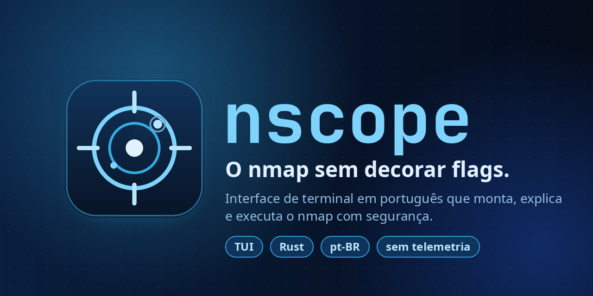
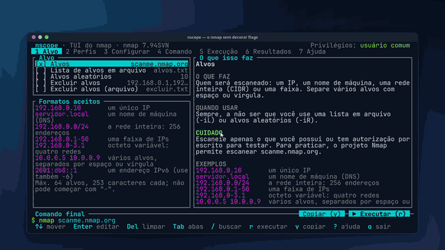
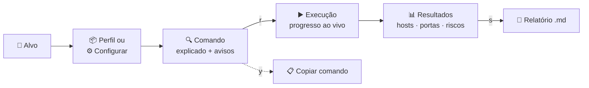
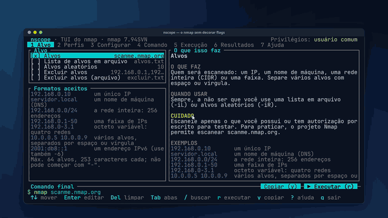
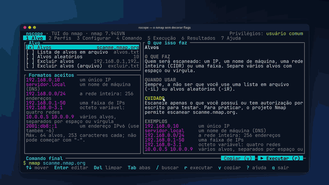
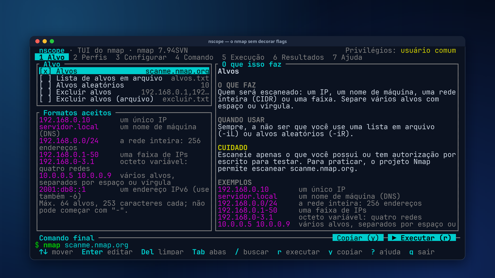
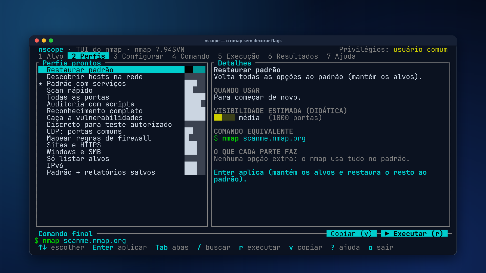
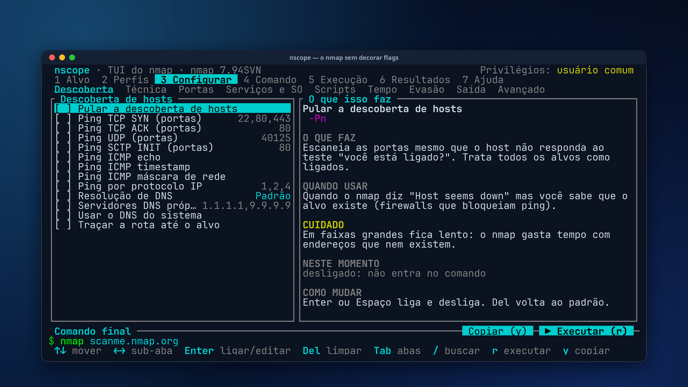
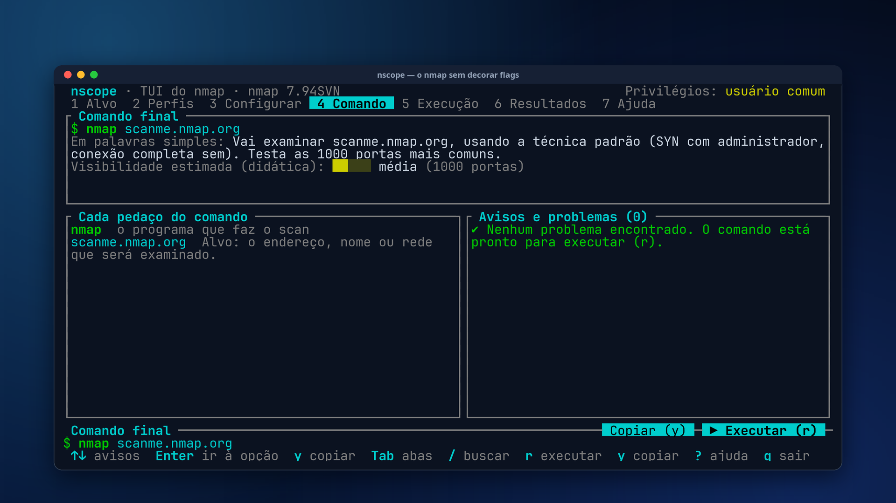

<div align="center">



<br>


**Monta o comando do nmap, explica cada pedaço, avisa dos riscos antes de rodar e mostra o resultado de um jeito que dá para navegar.**
Tudo no terminal, em português, no estilo lazygit.

[🚀 Instalar](#-instalação) · [🎬 Ver em ação](#-veja-funcionando) · [🎹 Atalhos](#-atalhos) · [🔐 Segurança](#-segurança-modelo-de-ameaças-resumido) · [🤝 Contribuir](#-como-contribuir)



<sub>Gravado de verdade: o nscope executando o nmap contra <code>scanme.nmap.org</code>, o alvo de testes do projeto Nmap. <a href="docs/media/fluxo.mp4">▶ Versão em MP4 (1080p, 30 fps)</a></sub>

</div>

> ⚠️ **Aviso legal:** use o nscope (e o nmap) apenas em sistemas que você possui ou para os quais tem **autorização por escrito**. Escanear sem permissão pode ser crime. Para praticar, use `scanme.nmap.org` (o projeto Nmap permite, com moderação) ou um laboratório seu.

O nscope **não reimplementa o nmap**: ele executa o `nmap` instalado no seu sistema, sem shell, e só isso. Sem telemetria, sem conexões de rede próprias.

> 🖥️ É um programa **de terminal**: abra um terminal (Windows Terminal, GNOME Terminal, iTerm2...) e rode `nscope`. Precisa de pelo menos **80×24**.

## ✨ Por que usar

| | |
|---|---|
| 🧠 **Todo comando é explicado** | Para cada opção: o que faz, quando usar e o cuidado. Cada pedaço do comando final tem uma explicação ao lado. |
| 🎨 **Comando sempre visível** | Barra fixa e colorida, com cópia por tecla (`y`). |
| 🛡️ **Segurança na frente** | Avisos de privilégio, conflito, escopo e risco **antes** de executar. Alvo fora de rede privada exige confirmação (padrão *Não*). |
| 🧰 **Cobertura total** | ~110 opções em telas próprias, 16 perfis prontos e um campo livre para qualquer flag nova ou rara. Veja o [catálogo](docs/CATALOGO.md). |
| ⌨️ **Teclado primeiro, mouse opcional** | Funciona com `NO_COLOR` e em terminais de 16 cores. |
| 🔎 **Busca global** | `/` encontra qualquer opção por nome, flag ou descrição e salta até ela. |
| 🧾 **Relatório em Markdown** | `s` salva o resultado, sem sobrescrever arquivos existentes. |
| 🤝 **Honesto** | Sem o nmap instalado, a interface monta comandos e diz como instalar. Nunca inventa resultado. |

## 🧭 Como funciona



> Por baixo: o nscope chama `nmap` com uma **lista de argumentos** (nunca por um shell), lê o XML (`-oX`) que o próprio nmap gera e desenha na tela. Nada além disso.

## 🚀 Instalação

Você precisa de **dois programas**: o **nmap** e o **nscope**.

### 1) Instale o nmap

| Sistema | Comando |
|---|---|
| Debian / Ubuntu / Mint | `sudo apt install nmap` |
| Fedora / RHEL | `sudo dnf install nmap` |
| Arch / Manjaro | `sudo pacman -S nmap` |
| macOS (Homebrew) | `brew install nmap` |
| **Windows** (PowerShell) | `winget install Insecure.Nmap` *(instala também o Npcap, necessário para scans avançados)* |

Confira: `nmap --version`

### 2) Instale o nscope

#### Linux e macOS — compilando do código-fonte

```bash
# 2.1 Rust (se ainda não tiver). Requer Rust 1.88 ou mais novo.
curl --proto '=https' --tlsv1.2 -sSf https://sh.rustup.rs | sh
. "$HOME/.cargo/env"

# 2.2 baixe e instale o nscope
git clone https://github.com/SEU-USUARIO/nscope.git     # troque pela URL do repositório
cd nscope
cargo install --path . --locked

# 2.3 rode
nscope
```

O binário fica em `~/.cargo/bin/nscope`.

#### Windows (PowerShell) — compilando do código-fonte

```powershell
# 2.1 Rust e ferramentas de compilação
winget install Rustlang.Rustup
winget install Microsoft.VisualStudio.2022.BuildTools   # marque "Desenvolvimento para desktop com C++"

# 2.2 (feche e reabra o PowerShell) baixe e instale o nscope
git clone https://github.com/SEU-USUARIO/nscope.git     # troque pela URL do repositório
cd nscope
cargo install --path . --locked

# 2.3 rode no Windows Terminal ou PowerShell
nscope
```

#### Binários prontos (quando houver uma release)

Cada release publica binários para Linux (musl), macOS (x86_64 e arm64) e Windows, junto com `SHA256SUMS.txt`, SBOM CycloneDX e atestado de build.

```bash
# Linux / macOS
REPO=SEU-USUARIO/nscope; V=v0.1.0; T=x86_64-unknown-linux-musl   # ou x86_64-apple-darwin / aarch64-apple-darwin
curl -LO https://github.com/$REPO/releases/download/$V/nscope-$V-$T.tar.gz
curl -LO https://github.com/$REPO/releases/download/$V/SHA256SUMS.txt
sha256sum -c --ignore-missing SHA256SUMS.txt        # no macOS: shasum -a 256 -c --ignore-missing SHA256SUMS.txt
gh attestation verify nscope-$V-$T.tar.gz --repo $REPO   # opcional: verifica a origem do build
tar xzf nscope-$V-$T.tar.gz && sudo install nscope-$V-$T/nscope /usr/local/bin/
```

```powershell
# Windows
$Repo="SEU-USUARIO/nscope"; $V="v0.1.0"; $T="x86_64-pc-windows-msvc"
Invoke-WebRequest "https://github.com/$Repo/releases/download/$V/nscope-$V-$T.zip" -OutFile nscope.zip
Invoke-WebRequest "https://github.com/$Repo/releases/download/$V/SHA256SUMS.txt" -OutFile SHA256SUMS.txt
(Get-FileHash nscope.zip -Algorithm SHA256).Hash.ToLower()   # compare com a linha do nscope-...zip em SHA256SUMS.txt
Expand-Archive nscope.zip -DestinationPath .
.\nscope-$V-$T\nscope.exe
```

### Privilégios (sudo / administrador)

Várias técnicas (SYN `-sS`, UDP `-sU`, detecção de SO `-O`...) exigem administrador. O nscope **nunca se eleva sozinho**: ele detecta, mostra na barra de título e bloqueia a execução com uma mensagem clara se faltar.

- **Linux/macOS:** `sudo "$(command -v nscope)"` (o `sudo` costuma não enxergar `~/.cargo/bin` no PATH, por isso o `command -v`).
- **Windows:** abra o *Windows Terminal* **como administrador** e rode `nscope`.
- Se o seu `nmap` tem *capabilities* (Linux), use *Configurar → Avançado → Modo de privilégios → Assumir administrador*.

## 🧪 Uso em 4 passos

1. **Alvo (`1`)**: digite o que escanear (um IP, um nome, `192.168.0.0/24`...). A validação é ao vivo.
2. **Perfis (`2`) ou Configurar (`3`)**: aplique um perfil pronto (★ *Padrão com serviços* é o recomendado) ou ajuste opção por opção. A tela da direita explica tudo.
3. **Comando (`4`)**: revise o comando final, o resumo "em palavras simples", a visibilidade estimada e os avisos (`Enter` salta até a opção responsável).
4. **Execução (`5`)**: `r` executa, `c` cancela. Ao terminar, veja os **Resultados (`6`)**.

Para abrir um XML que você já tem: `nscope --open scan.xml`. Para só imprimir um comando: `nscope --print-command --profile "Scan rápido" --target 192.0.2.10`.

## 🎹 Atalhos

| Tecla | Ação |
|---|---|
| `Tab` / `Shift+Tab`, `1`–`7` | trocar aba principal |
| `←` `→` ou `[` `]` | sub-aba (Configurar) / painel (Resultados) |
| `↑` `↓` ou `j` `k` | mover seleção / rolar |
| `Enter` / `Espaço` | ligar-desligar, trocar valor, editar texto |
| `Shift+Enter` ou `-` | valor anterior em opções de escolha |
| `Del` | limpar a opção (volta ao padrão) |
| `/` | busca global: filtra qualquer opção por nome, flag ou descrição e salta até ela |
| `r` / `c` | executar / cancelar |
| `y` | copiar o comando (OSC 52, com mensagem de fallback) |
| `o` / `s` | Resultados: só portas abertas / salvar relatório Markdown |
| `?` | Ajuda |
| `q` / `Ctrl+C` | sair (encerra o scan em andamento) |

Na edição de texto: `Enter` confirma, `Esc` cancela e restaura, o comando atualiza enquanto você digita.
Mouse (opcional): clique em abas, sub-abas e linhas.

## 🎬 Veja funcionando

Tudo abaixo foi **gravado do programa de verdade** (o nmap rodando contra `scanme.nmap.org`), com mouse, teclado e zoom nos pontos importantes. Cada vídeo tem versão MP4 em 1080p e 30 fps.

### 1. Do alvo ao resultado em menos de um minuto

Um scan de verdade contra `scanme.nmap.org`: alvo, perfil, comando explicado, execução e resultados. A espera do scan foi acelerada 3× no vídeo.

<div align="center">


<sub><a href="docs/media/fluxo.mp4">▶ Assistir em MP4 (1080p, 30 fps)</a></sub>
</div>

### 2. Mais de 110 opções, todas explicadas

Cada opção diz **o que faz, quando usar e o cuidado**. O comando muda na hora, e a busca (`/`) acha qualquer opção por nome, flag ou descrição.

<div align="center">


<sub><a href="docs/media/configurar.mp4">▶ Assistir em MP4 (1080p, 30 fps)</a></sub>
</div>

### 3. Segurança antes de executar

Avisos de privilégio, conflitos e risco aparecem **antes** de rodar. Alvo fora da sua rede abre uma confirmação cujo padrão é **Não**. Neste vídeo o `8.8.8.8` só é digitado: a confirmação é cancelada e nada vai para a rede.

<div align="center">


<sub><a href="docs/media/seguranca.mp4">▶ Assistir em MP4 (1080p, 30 fps)</a></sub>
</div>

### 🖼️ Galeria

<table>
<tr>
<td align="center"><br><sub><b>1 · Alvo</b>: formatos aceitos e validação ao vivo</sub></td>
<td align="center"><br><sub><b>2 · Perfis</b>: 16 receitas prontas, com a visibilidade de cada uma</sub></td>
</tr>
<tr>
<td align="center"><br><sub><b>3 · Configurar</b>: 9 sub-abas, uma ajuda por opção</sub></td>
<td align="center"><br><sub><b>4 · Comando</b>: cada pedaço explicado e os avisos</sub></td>
</tr>
</table>

<details>
<summary>📟 Prefere texto puro? Capturas reais da interface em 80×24</summary>

**Configurar → Portas** (lista à esquerda, "O que isso faz" à direita):
```text
 nscope · TUI do nmap · nmap 7.95                    Privilégios: usuário comum
 1 Alvo  2 Perfis  3 Configurar  4 Comando  5 Execução  6 Resultados  7 Ajuda
 Descoberta  Técnica  Portas  Serviços e SO•1  Scripts  Tempo  Evasão  Saída•1 ›
┌ Portas ────────────────────────────┐┌ O que isso faz ────────────────────────┐
│[ ] Quais portas escanear     Padrão││Quais portas escanear                   │
│[ ] Excluir portas          9100,515││                                        │
│[ ] Portas em ordem sequencial      ││O QUE FAZ                               │
│                                    ││Cada serviço de rede escuta em uma porta│
│                                    ││(web: 80/443, SSH: 22). Aqui você       │
│                                    ││escolhe quantas e quais testar.         │
│                                    ││                                        │
│                                    ││QUANDO USAR                             │
│                                    ││Padrão para começar; "Todas" quando     │
│                                    ││precisa de cobertura total; "Lista"     │
│                                    ││quando já sabe o que procura.           │
│                                    ││                                        │
│                                    ││CUIDADO                                 │
│                                    ││Todas as 65535 portas podem levar muitos│
│                                    ││minutos e geram bastante tráfego.       │
│                                    ││                                        │
└────────────────────────────────────┘└────────────────────────────────────────┘
 Comando final ─────────────────────────────────── Copiar (y) ─ ▶ Executar (r) ─
$ nmap -sV -oA relatorio scanme.nmap.org
 ↑↓ mover  ←→ sub-aba  Enter ligar/editar  Del limpar  Tab abas  / buscar
```

**Comando** (comando final, palavras simples, ruído estimado, cada pedaço e avisos):
```text
 nscope · TUI do nmap · nmap 7.95                    Privilégios: usuário comum
 1 Alvo  2 Perfis  3 Configurar  4 Comando  5 Execução  6 Resultados  7 Ajuda
┌ Comando final ───────────────────────────────────────────────────────────────┐
│$ nmap -sV -oA relatorio scanme.nmap.org                                      │
│Em palavras simples: Vai examinar scanme.nmap.org, usando a técnica padrão    │
│(SYN com administrador, conexão completa sem). Testa as 1000 portas mais      │
│comuns. Identifica o serviço e a versão de cada porta aberta. Salva o         │
│resultado em: -oA relatorio.                                                  │
│Visibilidade estimada (didática): ███░░ alta (1000 portas, detecção de versão)│
│                                                                              │
└──────────────────────────────────────────────────────────────────────────────┘
┌ Cada pedaço do comando ────────────────┐┌ Avisos e problemas (0) ────────────┐
│nmap  o programa que faz o scan         ││✔ Nenhum problema encontrado. O     │
│-sV  Além de saber que a porta está     ││comando está pronto para executar   │
│aberta, pergunta ao serviço quem ele é: ││(r).                                │
│"nginx 1.18" em vez de só "http".       ││                                    │
│Essencial para achar software           ││                                    │
│desatualizado.                          ││                                    │
│-oA relatorio  Salva em texto, XML e    ││                                    │
│grepável de uma vez, usando o nome-base ││                                    │
└────────────────────────────────────────┘└────────────────────────────────────┘
 Comando final ─────────────────────────────────── Copiar (y) ─ ▶ Executar (r) ─
$ nmap -sV -oA relatorio scanme.nmap.org
 ↑↓ avisos  Enter ir à opção  y copiar  Tab abas  / buscar  r executar
```

**Resultados** (hosts · portas · detalhes):
```text
 nscope · TUI do nmap · nmap 7.95                    Privilégios: usuário comum
 1 Alvo  2 Perfis  3 Configurar  4 Comando  5 Execução  6 Resultados  7 Ajuda
 3 hosts (2 ligados) · 14.5 s · nmap -sV -O --traceroute 192.0.2.0/24
 ☐ só abertas (o) · s salva relatório Markdown
┌ Hosts ─────────────────┐┌ Portas ◂ ──────────────────────────────────────────┐
│● 192.0.2.10 serv… 2 ab.││PORTA    ESTADO         SERVIÇO       VERSÃO        │
│● 192.0.2.20       1 ab.││22/tcp   open           ssh           OpenSSH 8.9p1…│
│○ 192.0.2.30       0 ab.││443/tcp  open           http          nginx 1.18.0  │
│                        ││3306/tcp filtered       mysql                       │
│                        ││123/udp  open|filtered  ntp                         │
│                        ││Não exibidas: 995 portas closed (resets)            │
│                        ││                                                    │
│                        │└────────────────────────────────────────────────────┘
│                        │┌ Detalhes ──────────────────────────────────────────┐
│                        ││22/tcp ssh · SSH                                    │
│                        ││open · motivo: syn-ack                              │
│                        ││                                                    │
│                        ││SIGNIFICA                                           │
│                        ││Há um serviço escutando e aceitando conexões.       │
│                        ││                                                    │
└────────────────────────┘└────────────────────────────────────────────────────┘
 Comando final ─────────────────────────────────── Copiar (y) ─ ▶ Executar (r) ─
$ nmap -sV -oA relatorio scanme.nmap.org
 ↑↓ mover  ←→ painel  o só abertas  s salvar  Tab abas  / buscar  r executar
```

</details>

> 🎞️ Os vídeos são gerados por [`docs/demo/gerar.py`](docs/demo/gerar.py), que controla o nscope num pseudoterminal e renderiza os quadros (cursor, cliques, zoom). Para refazer: `python3 -m venv .venv && .venv/bin/pip install pyte pillow` e depois `.venv/bin/python docs/demo/gerar.py` (precisa de `ffmpeg`, `nmap` e do `nscope` no PATH). A logo sai de [`docs/demo/logo.py`](docs/demo/logo.py).

## 🧩 Recursos

- 7 telas: Alvo · Perfis · Configurar (Descoberta · Técnica · Portas · Serviços e SO · Scripts · Tempo · Evasão · Saída · Avançado) · Comando · Execução · Resultados · Ajuda.
- 16 perfis prontos (descobrir hosts, padrão com serviços, vulnerabilidades, discreto, UDP, firewall, web, SMB, IPv6, relatórios...).
- Navegador de scripts NSE (categorias e scripts populares, com marcação de risco).
- Análise antes de executar: erros (bloqueiam), avisos e informações; opções que exigem admin viram erro com "rode com sudo".
- Resultados do XML: hosts, portas (cores por estado, "Não exibidas: N portas closed"), SO, rota, scripts e uma base local de portas comuns com nível de atenção.
- Relatório Markdown (`s`), criado sem sobrescrever arquivos existentes.
- Terminal sempre restaurado (também em pânico e `Ctrl+C`); temporários sempre removidos.

## 🔐 Segurança (modelo de ameaças resumido)

Detalhes e política de divulgação em [SECURITY.md](SECURITY.md).

- **Sem shell**: `Command::new("nmap")` com argumentos em lista; alvos e valores por lista de permitidos; alvo nunca começa com `-`; campo de flags extras recusa `; & | \ $ < > ( )` e o acento grave.
- **Texto da rede nunca altera o terminal**: banners, hostnames e saída de scripts são sanitizados (ESC e controles viram `·`; bidi e largura zero neutralizados), com testes.
- **Temporários** em diretório `0700` único, removidos ao terminar/cancelar/sair/falhar.
- **Limites**: XML ≤ 64 MiB, linhas lidas ≤ 8 KiB, 5000 linhas de log em memória.
- **Autorização**: confirmação explícita para alvos fora de redes privadas (padrão *Não*).
- **Não protege**: o próprio nmap/NSE, a autorização legal, um sistema já comprometido, `SIGKILL`.

## 📦 Dependências (todas justificadas)

| Crate | Por quê |
|---|---|
| `ratatui` | interface de terminal (reexporta o `crossterm`, que cuida do terminal/teclado/mouse) |
| `roxmltree` | ler o XML do nmap, sem `unsafe`, com limites de expansão de entidades |
| `shell-words` | **só** separar os argumentos do campo de flags extras (nunca executa em shell) |
| `unicode-width` | largura de colunas correta no campo de texto e nas tabelas |
| `insta` *(dev)* | testes de snapshot das telas |

## 🔧 Desenvolvimento

```bash
cargo fmt --check
cargo clippy --all-targets --locked -- -D warnings
cargo test --locked                   # unitários + snapshots + integração com um nmap FALSO (sem rede)
cargo deny check && cargo audit       # licenças e vulnerabilidades
```

Rust 1.88+ para compilar (1.89+ para rodar os testes, por causa do `insta`). Arquitetura em [docs/ARQUITETURA.md](docs/ARQUITETURA.md); decisões em [docs/DECISOES.md](docs/DECISOES.md).

## 🤝 Como contribuir

1. Abra uma issue descrevendo a mudança (falhas de segurança: veja [SECURITY.md](SECURITY.md), **não** use issue pública).
2. Faça o fork, crie um branch, rode os comandos de *Desenvolvimento* acima.
3. Texto de interface em português simples, escrito com as suas palavras (não copie o `man nmap`).
4. Nas fixtures, use só `192.0.2.0/24` e nomes `*.exemplo.test`.

### Como adicionar uma opção ao catálogo

Cada opção é um dado em `src/nmap/catalog.rs`:

```rust
n(Tempo, "minrate", "--min-rate", "Taxa mínima (pacotes/s)", "Texto simples do que faz.", 1, 10_000_000)
    .ph("1000").caution("Taxas altas podem sobrecarregar a rede."),
```

Rode `UPDATE_CATALOG=1 cargo test catalogo` para atualizar [docs/CATALOGO.md](docs/CATALOGO.md) e adicione regras em `src/nmap/analyze.rs` se a opção tiver conflitos. Um teste confere que **toda** opção do catálogo emite exatamente a sua flag.

## 📄 Licença

[MIT](LICENSE).
